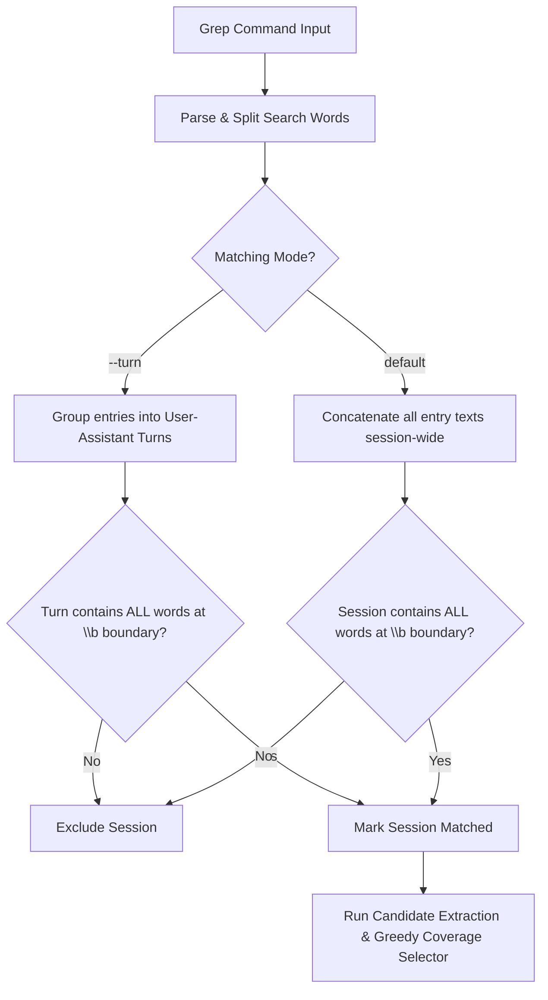
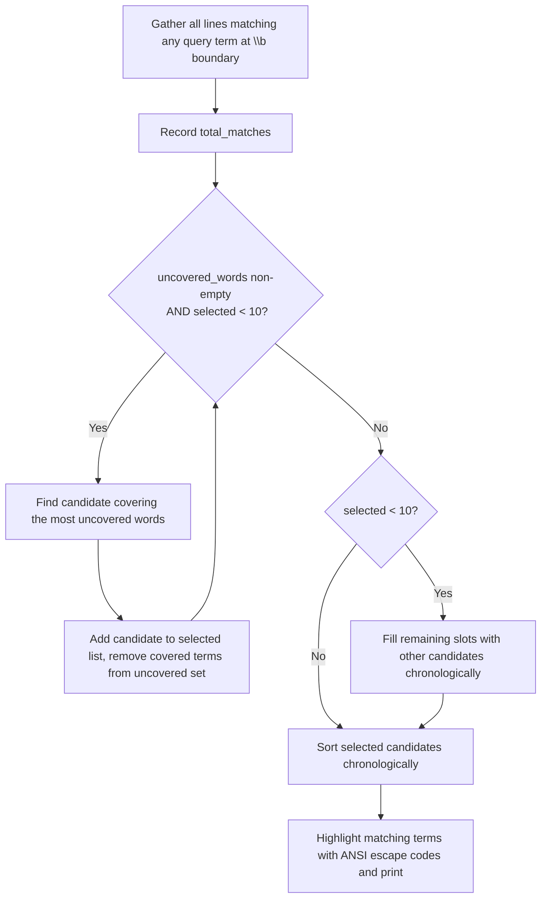

# pi-explore Grep Matching & Snippet Selection Logic

This document details the internal workflow of the `--grep` search engine in `pi-explore`. The search engine follows two design principles:
1. **Accurate Multi-Term Filtering**: Strict logical AND matching across search terms on a session-wide or turn-restricted scale, using word-boundary checks (`\b`) to eliminate substring and base64 false positives.
2. **Fair Snippet Visualization**: A greedy coverage-based snippet selector that guarantees all matched search terms are represented in the displayed terminal snippets.

---

## 1. Matching & Filtering Pipeline

### Word Boundary Matching
To prevent false matches (such as searching for `i3` matching inside long base64 hashes, CSS dimensions, or random IDs like `10Gi3`), the matching logic enforces a leading word boundary (`\b`):
- **Match:** `i3-msg`, `i3wm`, `nginx.conf`, `o365`
- **Ignore:** `10Gi3`, `base64_i3...`

---

## 2. Snippet Extraction & Greedy Coverage Selector

Once a conversation log matches all search terms, `pi-explore` retrieves and prioritizes matching lines for display (capped at 10 total snippets).

### The Greedy Coverage Selection Algorithm

1. **Candidate Gathering**:
   - Every line in the session that contains at least one search word at a `\b` boundary is captured as a candidate.
   - The total number of matching lines is tracked as `total_matches`.

2. **Pass 1: Coverage Phase**:
   - An `uncovered_words` set is initialized with all search terms.
   - The algorithm greedily picks candidates that cover the largest number of remaining uncovered words.
   - This ensures that if the user searches `--grep mailman migration postfix`, lines mentioning all three terms are prioritized over lines mentioning only `mailman`.

3. **Pass 2: Chronological Backfill**:
   - If fewer than 10 snippets were selected, remaining slots are filled with other matching lines in chronological order up to the 10-snippet limit.

4. **Terminal Rendering**:
   - Matching words are highlighted with `CLR_BOLD + CLR_YELLOW`.
   - Each snippet is prepended with its step number and descriptor, e.g.:
     `[Step 36 | Assistant Response] 3. mailman 2.1 is a hard blocker.`
     `[Step 37 | User Prompt] migrate to mailman3`
