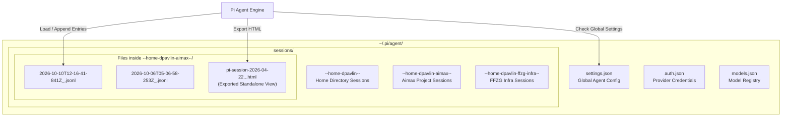
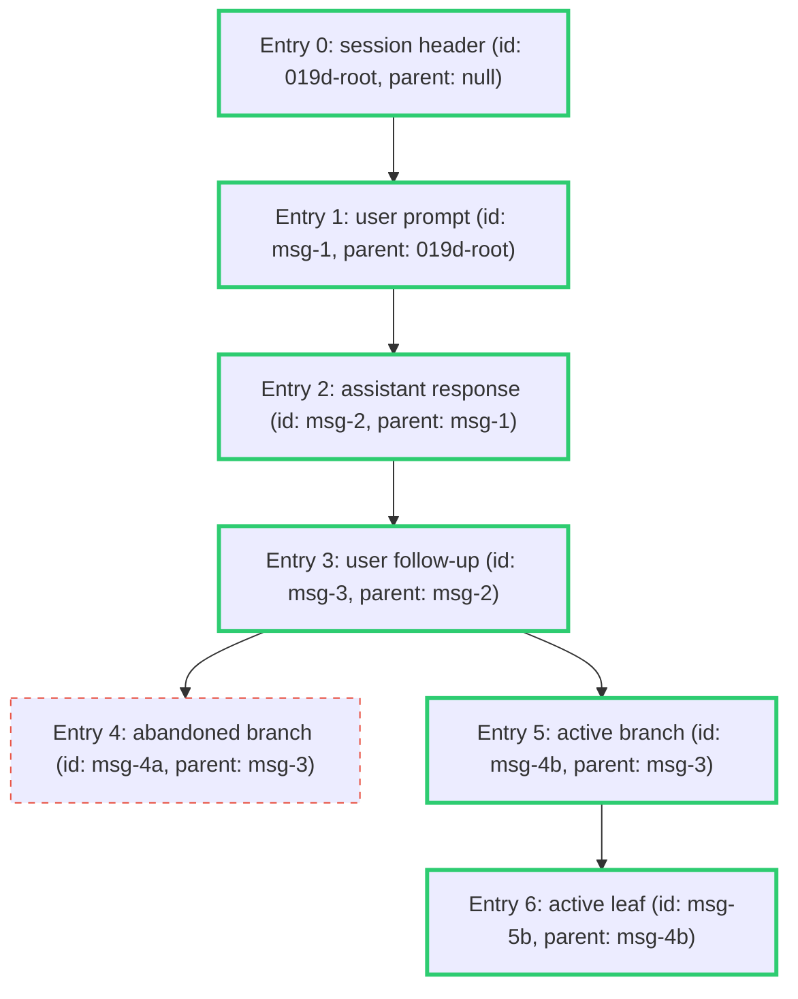

# Pi Coding Agent Session Architecture & Storage Internals

This document provides a technical specification and engineering reference for the session storage format, tree traversal algorithms, and telemetry systems used by the **Pi coding agent** ([`@earendil-works/pi-coding-agent`](https://github.com/earendil-works/pi-coding-agent)).

---

## 1. Storage Topology & Overview

Pi stores conversation sessions as append-only trees in JSON Lines (`.jsonl`) files. Rather than storing sessions in a centralized database, each workspace directory has its own dedicated folder under `~/.pi/agent/sessions/`:



### Path Encoding Rules

To safely encode any arbitrary filesystem path into a directory name under `sessions/`, Pi applies the following transformation:
1. Resolves the absolute canonical path (`os.path.realpath(cwd)`).
2. Strips leading slashes or backslashes (`^[/\\\\]`).
3. Replaces all separators and colons (`/`, `\`, `:`) with hyphens (`-`).
4. Surrounds the string with double hyphens (`--...--`).

**Examples:**
- `/home/dpavlin` &rarr; `--home-dpavlin--`
- `/home/dpavlin/aimax` &rarr; `--home-dpavlin-aimax--`
- `/home/dpavlin/mjesec-upgrade-amd64` &rarr; `--home-dpavlin-mjesec-upgrade-amd64--`
- `/tmp` &rarr; `--tmp--`

---

## 2. Tree Trajectory & Branching Model

Each JSONL file is not merely a linear transcript; it represents an **append-only tree of entries**. Every entry has an `id` and a `parentId` (or `null` for root):



### Active Trajectory Walk (`build_active_path`)

When rendering the coherent active conversation, `pi-explore` follows Pi's context projection algorithm:
1. Select the final entry in the file as the active leaf (`entries[-1]`).
2. Walk backwards through `parentId` until reaching root (`parentId == null`).
3. Reverse the gathered list to form chronological active order.

Any entries belonging to abandoned branches are omitted by default, preventing discarded attempts from cluttering the transcript. The `--all-entries` flag disables this filtering to allow full inspection of every historical branch.

---

## 3. Entry Types & Schema Breakdown

Each line in a `.jsonl` session file contains a serialized JSON object with a `type` field:

### 1. `session` (Header, Line 0)
The first line of every valid Pi session defines the session metadata:
```json
{
  "type": "session",
  "version": 3,
  "id": "01a11aa2-e256-736e-ad11-d1462063bcd5",
  "timestamp": "2026-10-08T08:30:44.823Z",
  "cwd": "/home/dpavlin/ffzg-infra",
  "parentSession": null
}
```

### 2. `message`
Represents dialog turns and tool executions.

#### `role: "user"`
```json
{
  "type": "message",
  "id": "msg-u1",
  "parentId": "parent-id",
  "timestamp": "2026-10-08T08:31:06.100Z",
  "message": {
    "role": "user",
    "content": [
      { "type": "text", "text": "examine last few commits about o365 migration" }
    ]
  }
}
```

#### `role: "assistant"`
Assistant messages contain structured content blocks (`thinking`, `text`, `toolCall`), model details, and usage metrics:
```json
{
  "type": "message",
  "id": "msg-a1",
  "parentId": "msg-u1",
  "timestamp": "2026-10-08T08:32:07.450Z",
  "message": {
    "role": "assistant",
    "provider": "halogen-flash",
    "model": "halogen-qwen3.8-flash-next",
    "content": [
      {
        "type": "thinking",
        "thinking": "Exploring repository to inspect recent migration commits."
      },
      {
        "type": "text",
        "text": "I'll examine the commits."
      },
      {
        "type": "toolCall",
        "id": "bash_179145",
        "name": "bash",
        "arguments": { "command": "git log --oneline -5" }
      }
    ],
    "usage": {
      "input": 1200,
      "output": 350,
      "cacheRead": 15000,
      "cacheWrite": 0,
      "totalTokens": 16550,
      "cost": { "total": 0.00015 }
    },
    "stopReason": "toolUse"
  }
}
```

#### `role: "toolResult"`
Contains tool execution output, duration, and error status:
```json
{
  "type": "message",
  "id": "msg-tr1",
  "parentId": "msg-a1",
  "timestamp": "2026-10-08T08:32:07.470Z",
  "message": {
    "role": "toolResult",
    "toolCallId": "bash_179145",
    "toolName": "bash",
    "durationMs": 20,
    "isError": false,
    "content": [
      { "type": "text", "text": "fb87b69 o365: sync aliases script\n..." }
    ]
  }
}
```

### 3. `compaction` & `branch_summary`
When a conversation exceeds context limits or forks, Pi produces structured checkpoint summaries:
- `tokensBefore`: Token count before reduction.
- `summary`: Markdown overview of goals, progress, decisions, and next steps.
- `details.modifiedFiles`: Array of workspace files touched prior to compaction.
- `details.readFiles`: Array of workspace files inspected.

### 4. Configuration Changes
- `model_change`: `{"provider": "...", "modelId": "..."}`
- `thinking_level_change`: `{"thinkingLevel": "off" | "low" | "medium" | "high"}`
- `session_info`: `{"name": "user-defined-session-name"}`

---

## 4. Telemetry & Cost Accounting

Pi records token usage in every assistant turn. `pi-explore` aggregates these metrics to compute:
- **Total Tokens:** Input + Output + Cache Reads + Cache Writes.
- **Cache Hit Ratio:** Percentage of prompt tokens served from model provider KV-cache.
- **Monetary Cost:** Sum of exact dollar figures computed by Pi's provider pricing engine.
